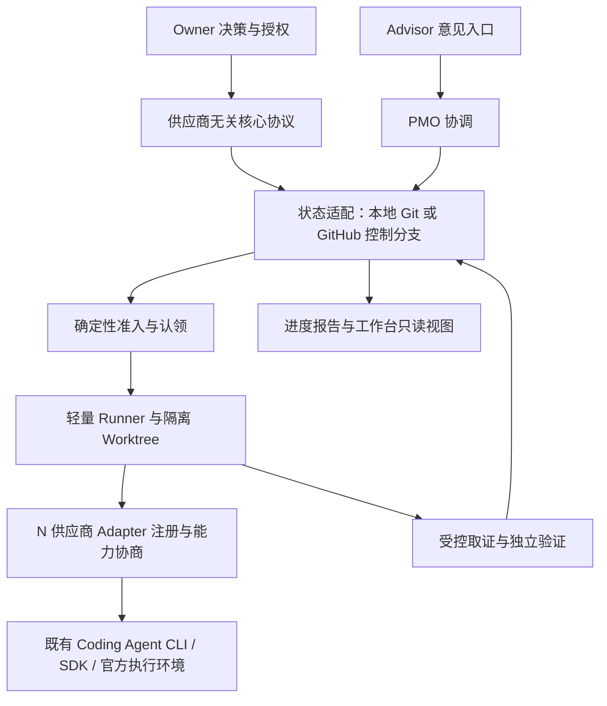
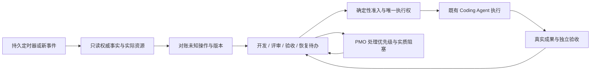

# V4 目标架构与协议

版本：0.2，2026-11-28。状态：滚动架构与实现边界。核心协议及部分本地组件已有实测；
真实供应商、完整 Alpha 和 Team 权威后端仍有未验收项。§14 是结合运行实践的新提案。
事实基线见 [V3_INVENTORY.md](V3_INVENTORY.md)，重大选择见 [OWNER_DECISIONS.md](OWNER_DECISIONS.md)。

## 1. 层次与模块边界

| 模块 | 拥有的职责 | 不承担的职责 |
|---|---|---|
| Core | Schema、状态迁移、授权/风险/依赖判断、事件校验 | 调用某家模型、持有登录凭证 |
| State Adapter | 原子提交、版本冲突、查询、持久化事件和认领 | 判断业务验收是否通过 |
| Runner | 检查认领、隔离目录、命令执行、进程生命周期、捕获产物 | 伪造评审或扩展权限 |
| Provider Adapter | 能力声明、合法授权引用、将统一请求转为原生 CLI/SDK 调用、映射结果 | 模型推理/编辑引擎、第二套 PMO、业务规则、跨供应商原生会话转换 |
| Quality/Governance | 验证证据来源、签认版本、契约影响和偏离 | 用模型自报替代工具执行记录 |
| Recovery | 保全成果、对账、撤销旧执行权、交接 | 直接执行上次的未知操作 |
| Coordination | Ready Set、分派建议、进度投影、Advisor 台账 | 绕过 Owner 范围、独立验收、调度互斥 |

建议逐步引入 `framework/{organization,workflow,governance,quality,recovery}`、`schemas/`、`templates/`、`adapters/{claude-code,codex,github,local}`、`profiles/`、`examples/`。不先创建空目录。现有 `CC_COLLABORATION/` 保留到兼容测试完成。

## 2. 核心实体与身份

| 实体 | 标识与主要属性 | 生命周期 |
|---|---|---|
| Role | role_id、职责、可操作资源/动作、禁止项、冲突角色 | 长期，不绑定 Session |
| Worker | worker_id、可承担角色、capabilities、provider/host、并发槽、状态、heartbeat、usage 可知性 | 可上线/离线/暂停/退役 |
| Provider | provider_id、产品/CLI 版本、支持能力与限制 | 适配器版本化 |
| Agent Tool / Model Provider / Model | 执行工具、实际模型供应商和模型分别引用；未知模型为 null | 一个工具可配置多个供应商，一个供应商可有多个执行入口；不能用旧 Provider 字段隐含一对一 |
| Credential Reference / Quota Group | 合法授权的 opaque reference、实际共享限制组 | 不保存明文凭证；多个 Worker 可共用额度组，不能把进程数量当成独立额度 |
| Host | host_id、OS/架构、工具链、隔离与网络策略、可用性 | 设备或云执行环境 |
| Session | session_id、worker_id、native_session_ref（可空）、开始/终止时间 | 单次上下文 |
| Work Package | wp_id、定义版本、策略版本、交付与验收范围 | 跨 Session 持久 |
| Assignment | assignment_id、wp_id、worker_id、角色绑定、lease、fencing_token | 一次有期限的执行权 |

认证主体 principal 与扮演的角色分开记录。`role=reviewer` 的文本声明不构成授权。身份来自受控身份绑定和执行环境，GitHub 同一登录名下的多个 Agent 不能天然证明职责隔离。

Owner 已明确产品是 **Multi-provider, Model-agnostic Engineering Resource Pool**。
Claude Code/Codex 是首批实际验证样本，不是核心二选一。最小实现以受信装配注册
Adapter，声明 auth、availability、start、status、stop、result、quota、recovery、
checkpoint、native_resume、logs、evidence 的 supported/unsupported/unknown，
并分别记录工具、模型供应商、模型、凭证引用与额度组。具体解析器可以识别供应商错误，
Scheduler/Recovery 只消费通用语义，不能凭供应商名决定配额、独立性或能力。
第三个合成 Adapter 在不修改核心任务/调度/恢复代码下跑完整链作为架构验收；
模拟执行、真实 CLI、自然额度事件三个等级分开。当前实现位置见
[Worker 生命周期增量](../../framework/local/LIFECYCLE.md)，不表示跨机服务已经部署。

实现者可以进行自测；高风险独立评审和独立验收不得由该成果的作者或其同一可写上下文承担。独立评审者默认只读被评对象、单独提交结论；合入者核验条件而不冒充评审者。Owner 决定战略、授权、成本和需其签认的事项；External Advisor 监督、建议和复核意见关闭，不派单、不替代验收。

## 3. 唯一权威状态源

### Lite

项目配置固定 `state_backend=local_git`。建议 `.ai-org/state.json` 为一个原子状态聚合，包含 WP、Assignments、授权引用、operation journal 和事件序号；用单机锁、版本比较、临时写入 + 原子替换管理更新，Git 保存检查点。锁文件不是状态源。

仅支持一个 Host 上的多进程受控访问；不把共享网盘文件锁当成跨机锁。待提交的状态与最后 checkpoint 分开标注；崩溃后核查状态版本和 Git 差异，再生成恢复事件。副本不能脱机并发派单。

### Team / Enterprise（待 OD-02 裁定）

OD-02 尚未定案。结合现有运行实践，修订推荐为：**Team 先验证 Issue 主账本、固定单写
协调者的最小模式**；不先强制建设控制分支和投影服务。这允许沿用已有协作习惯，但
不声称 Issue 普通字段具备原子认领或安全自动主备切换。并发执行可以存在，派单写者
仍必须唯一；自动认领/接管尚未验证的动作保持人工单写。具体取舍见 §14 与 OD-02。

以下保留 `state_backend=github_git` 的增强候选：**GitHub 上指定控制分支的状态提交
是唯一运行事实源**；Issue 是入口和展示、评论是变更请求/证据引用、标签及总看板是
可重建投影。本地 JSON/YAML 只是缓存，携带 `source_revision` 与 stale 标记，不得
离线授权或续领。两种模式只能显式选择一个，不同时把 Issue 与控制分支当主状态。

控制分支建议 `org-state`，不使用 main。每个事务从确定父提交读取状态，校验 expected_revision，生成只有该父提交的新 commit，以非强制、仅快进更新 ref 提交；两个基于同一父提交的竞争事务只能接受一个，失败者重新读取并重算，禁止盲目合并认领。WP/Assignment/作用域锁/操作意图在同一状态事务中更新。这个方案必须通过真实 GitHub 冲突实测后才能开启自动分派。[GitHub Git references API](https://docs.github.com/en/rest/git/refs#update-a-reference) 提供非强制更新；上述事务设计是本项目提案，非 GitHub 自动提供的任务锁。

单写者 principal 承担控制分支和 Issue 投影更新；云端、本地都只提交请求。分支限制强推和删除，并限制写者。普通 Worker 无控制分支写权限。Issue 被手工改标签不改变 canonical state；对同一 WP 发现多个状态标签应报警并修复投影，不能“选较高状态”。

如果部署环境无法可靠保护唯一写入和状态事务，降为人工协调，不能宣称多机排他已成立。仅靠 Actions concurrency 不能防本机并发写入；它只对相同组的 Actions 作业限流，不能替代任务账本。[官方说明](https://docs.github.com/en/actions/how-tos/write-workflows/choose-when-workflows-run/control-workflow-concurrency)

### 状态权威的分类

| 数据 | 权威 | 派生物 |
|---|---|---|
| 代码/规范内容 | 锁定 Git commit 的文件 | Agent 上下文、缓存 |
| WP 定义和运行状态 | 所选 backend 的一个 canonical revision；Issue 模式需明确正文/事件的权威字段 | 非权威字段、其他后端镜像、本地缓存、报表 |
| Owner 裁定 | 具备来源/对象/范围的本人决定记录 | PMO 摘要；不能自行扩展原话 |
| 签认 | 绑定 commit、范围和身份的评审/批准记录 | 文档中的状态标记 |
| 工程执行事实 | 受控执行记录 + 可检索原始产物 | Markdown 测试摘要 |

切换 backend 要冻结写入、处理未知操作、导出带指纹的完整状态、校验导入一致性、变更 authority_epoch、关闭旧写者后再启用新写者。不进行双主同步。

## 4. Work Package 协议草案

当前核心采用 JSON + JSON Schema 2020-12；人类编辑可用受限 YAML 转换，但转换后
同一语义，不维护两份主状态。下表描述协议目的；准确已实现字段以版本化 Schema 为准。

| 字段组 | 必填内容及约束 |
|---|---|
| 身份/追溯 | schema_version、project_id、wp_id 唯一；kind；title；objective；deliverables；goal_refs/requirement_refs |
| 责任 | accountable_role；implementer 的 assignment 引用；reviewer/acceptor/merger 的身份引用或“未配”；不得用空字符串表示已满足 |
| 输入/范围 | baseline_sha；spec_refs 的 path/version/sha256；inputs；allowed_paths、forbidden_paths；外部副作用许可；风险级别 |
| 依赖 | dependencies[{wp_id, required_milestone, artifact_revision}]；依赖环、缺失目标和不可满足条件拒绝 |
| 授权 | authorization_ref；授权主体、范围、环境、有效期、限制；拟议授权不能通过准入 |
| 验收 | positive_criteria、negative_criteria；required_milestones；测试策略；回退方式；不适用项理由 |
| 运行 | state、revision、blocking_conditions、assignment_ref、lease_expires_at、checkpoint_ref、handoff_refs |
| 交付 | submitted_sha；evidence_refs；review_refs；merge_sha；acceptance_ref；deployment/business refs（按类型） |

协议中“未配”“unknown”“not_applicable”必须是不同值。任务是否需要部署/业务验证在开工前确定，不能为提高完成率事后删减。

Ready Set 是 `(WP, Worker)` 的可执行匹配，不只是 WP 列表：定义有效、未结束且无未决变更、每项依赖里程碑及版本满足、有效授权、风险策略满足、评审资源按要求落实、Worker 能力/额度/并发可用、认领未被有效占用、文件与外部资源作用域不冲突、无结果未知操作。额度无法查询时标 unknown；策略可允许有预算上限的探测，不能自报无限可用。

Ready 是随 `source_revision / policy_revision / observed_at` 计算的判断，不是永久通行证。`claim` 在同一原子事务内重检所有条件并登记认领、Worker 槽和作用域锁。`start` 再核认领、授权和代码基线。

## 5. 状态机与里程碑

单一生命周期字段：`planned → ready → in_progress → submitted → in_review → accepted → closed`；旁路 `blocked / paused / cancelled`。这里 accepted 表示该类型 **所需里程碑全部满足**，不能推断部署或业务成功。每次迁移由事件驱动并校验条件；closed 只是记录收口。

独立里程碑记录：`review_passed`、`spec_ratified`、`merged`、`engineering_accepted`、`deployed`、`business_validated`。每项带对象版本和证据，可为 pending/passed/failed/not_applicable/invalidated；不存在单一可覆盖事实的“总完成度”。

| 类型 | 默认必需里程碑 | 可配置项 |
|---|---|---|
| spec | 内容评审、适用方签认、版本归档 | 代码合入仅作为文档发布，不是实现 |
| code | 独立技术评审（风险决定）、合入、工程验收 | 部署与业务验证通常由后继包承担 |
| review | 精确对象、独立性、可追溯结论、问题处置 | 不要求该包实现被评代码 |
| release | 已验收的输入版本、发布授权、部署、健康/回退验证 | 业务验证可以单独 WP，必须追踪 |
| business-validation | 目标/样本/观察窗口、真实结果、业务责任人判定 | 不用 PR 数量替代 |

`submitted → in_progress` 需新 revision 和返工理由；已签认对象实质修改，使受影响里程碑 invalidated 并重开受影响任务。取消不是完成；挂起不释放未知外部操作；未提供证据的历史 done 导入为 `legacy_unverified` 属性并进入 planned/blocked 待核，而不是 accepted。

## 6. Assignment、隔离与恢复

Assignment 保存：认领主体、有效期、heartbeat、递增 fencing_token、authority_epoch、workspace_id、base_sha、允许范围、最后 checkpoint 和撤销原因。过期只使旧执行权失效，不证明旧进程已停止。

本地每个实现任务独立 Worktree；多机使用独立 checkout/等价隔离。Worktree 隔离文件，不是安全沙盒。Runner 检查执行权，合入/外部写入入口拒绝过期 token；原 Worker 离线时不能继续获得共享写入权。不能确认旧进程停止的情况下，将旧目录隔离为只读取证，不把新 Worker 指向同一可写目录。

检查点包含：角色及授权引用、WP/revision、锁定规范、baseline 与 last_valid_commit、未提交 diff/untracked 文件的可恢复位置和指纹、已做/未做、测试证据、决策、阻塞、unknown operations、下一步、Assignment/期限。每个子任务完成、风险操作前后、会话切换时保存；长任务由可执行 Runner 定时触发，初始建议最长 10 分钟，不能仅写在 Prompt 中就视为自动保存。秘密文件不打包。

接管顺序：读取权威状态 → 核 Git status/diff/worktree 与检查点 → 保全未提交/未追踪成果 → 对账 unknown 操作 → 撤销旧认领并确认写入隔离 → 新代次认领 → 按锁定版本加载统一规则 → 验证检查点可用 → 执行下一步。任何歧义暂停受影响动作；不能 reset/clean 覆盖成果。

跨供应商只移交协议化状态和工程资产，不移植供应商原生 Session。native resume 可用于同供应商效率优化，但仍须重新核验当前执行权。

## 7. Evidence 与可执行 Gate

Evidence 包必须记录 evidence_id、wp_id/revision、run_id、attempt、runner_identity、subject_sha/subject_tree、测试代码与配置 SHA、environment/image/toolchain、policy_revision、argv/cwd、started_at/ended_at、exit_code/signal/timeout、passed/failed/skipped/not_run/expected 数量、既有与新增失败、artifact URI/size/SHA256、评审对象 SHA 和验收记录引用。

Gate 的步骤：

1. 校验 Schema、身份、授权、对象 SHA 和产物可访问性；缺数据返回 unverifiable/blocked。
2. 受控 Runner 从准确提交构建隔离环境，执行预先确定的命令。非测试型任务也运行相应文档/链接/Schema 检查。
3. 从退出码、机器报告和完整日志生成证据；解析失败、零用例、超时、必须测试未执行均不得伪装通过。
4. 核用例清单/负向用例和覆盖要求；通过数字不是唯一条件。既有失败要有基准运行及明确 Deviation，新增失败默认阻断。
5. 验证产物指纹、可信 Runner 来源、签认身份及版本；高风险由独立 Runner/验收者复跑。
6. 计算 Gate 结果，附原因和证据引用；Agent 不能直接写 passed 绕过验证。

哈希不防止作者同时伪造文件和哈希。Lite 的本机证据只能证明受控工具在该信任域的运行，不宣称抵御机器所有者恶意伪造；Team 高风险使用实施者不能改写的 CI/验收环境、受保护策略和签认。测试代码被偷换、只运行有利子集、伪造日志、对象 SHA 不同均属于验收反例。

命令执行采用 argv 数组、realpath 范围校验、符号链接检查、环境变量白名单、超时和子进程收束；不把字符串前缀白名单当沙盒。测试可执行代码仍不可信，需要宿主隔离和最小网络/凭证权限。

风险层：低风险检查适用文件；一般代码要求构建、测试和负向场景；权限/数据/资金/迁移/并发高风险按影响选择隔离、幂等、迁移反向、失败恢复、属性/变异测试；形式化模型只用于可表达且收益明确的高风险状态机，不要求所有项目使用。

## 8. 评审、合入与契约治理

评审记录包含 reviewer principal/role/session、与实现者的关系声明、对象 commit/tree/路径集合、规范版本、结论、发现、复核和必要签认者。仅模型不同不满足独立性。

默认对候选合入树运行检查。squash/rebase 产生不同 commit 时，通过 tree 与受评路径内容比较证明一致；若目标分支变化影响候选树，重跑集成验证，必要时重审。预先允许的机械改动必须列出具体路径/字段/转换，不能写“仅文档变化免审”。合入者核对 review、合入树和授权，不代签。

Contract Registry 登记 contract_id、权威路径、版本和内容指纹、owner、签认引用、依赖、适用范围。保留旧 Contract Resolver 的发现能力，但发现候选源有冲突时报告冲突，不按目录优先级静默决定谁正确。

变更治理链：Owner Decision/需求 → ADR → 受影响契约集合 → Schema/接口/权限/行为/测试影响 → 兼容性判断 → 按影响复签 → 更新锁定集合 → 关联 WP 与验收。Deviation 记录违背条款、实际实现版本、原因、风险、补救、责任、期限、退出条件、关闭证据；有计划不等于关闭。Traceability Matrix 追溯目标 → 需求 → WP → 契约 → 测试 → 业务验证，缺口和部分承接分别统计。

## 9. 执行适配与官方机制核查

核查日期：2026-11-26。版本/help 检查观察到 Claude Code `2.1.332`、Codex CLI `0.169.0`。随后按 Owner 新授权，实际通过现有 ChatGPT 登录运行一次 Codex 只读轮询唤起探针；这不证明双供应商集成或云端执行权限。Claude 真实模型任务仍未执行。版本存在本身不代表已认证或有额度。

| 表面 | 官方能力 | V4 方案 |
|---|---|---|
| Claude 项目规则 | `CLAUDE.md` 与导入机制 | 薄入口引用核心规则；不复制组织状态。见 [Memory](https://code.claude.com/docs/en/memory) |
| Claude Skills/Commands | `.claude/skills/<name>/SKILL.md`；旧 commands 仍兼容 | 迁移并验证旧平铺 Skills；禁止只改目录就宣称原生加载成功。见 [Skills](https://code.claude.com/docs/en/skills) |
| Claude Subagents | `.claude/agents/` 与 frontmatter | 旧 `.claude/subagents/` 不是当前文档的默认位置。见 [Subagents](https://code.claude.com/docs/en/sub-agents) |
| Claude 程序执行 | `claude -p`，结构化输出；Python/TypeScript Agent SDK | Alpha 优先 CLI 子进程；确有生命周期需要再引 SDK。见 [Headless](https://code.claude.com/docs/en/headless)、[SDK](https://code.claude.com/docs/en/agent-sdk/overview) |
| Codex 项目规则 | 分层 `AGENTS.md` | 薄入口引用同一核心，并校验嵌套指令冲突。见 [AGENTS.md](https://learn.chatgpt.com/docs/agent-configuration/agents-md) |
| Codex Skills | `.agents/skills/<name>/SKILL.md` | 同源生成供应商包装，测试漂移。见 [Skills](https://learn.chatgpt.com/docs/build-skills) |
| Codex 执行 | `codex exec --json`；SDK | 记录 JSONL 和 process exit；完成消息不是测试证据。见 [Non-interactive](https://learn.chatgpt.com/docs/non-interactive-mode)、[SDK](https://learn.chatgpt.com/docs/codex-sdk) |

统一请求：`run_id, operation_key, assignment_id, fencing_token, workspace, baseline_sha, rules_digest, task_ref, allowed_actions, budget, checkpoint_ref`。
统一返回：`started / running / submitted / needs_input / quota_exhausted / failed / cancelled / outcome_unknown`，附 native session ref、日志、证据和 checkpoint 引用。Provider 的 completed 仅映射为任务成果提交，不映射为工程 accepted。

原生权限控制保留。无人值守遇到必须人工授权的动作应返回 needs_input，不能默认关闭沙盒、绕过权限或共享个人登录。SDK 和云适配只在确认产品权限、计费和可执行接口之后实现，不写未经核实的“云调度 API”。

额度恢复是资源状态变化，不是新的开工授权。Provider Adapter 必须区分供应商额度/限流、项目预算和 Session 上下文容量；额度使用 `quota_scope_ref` 表达共享限制组，不公开账号凭证，组边界未知时显式标 unknown。耗尽后暂停该组新分派，其他独立资源按原准入继续。冷却依据可靠 retry_at 或有次数/时间/预算上限的退避，不能循环发模型任务试额度、共享个人凭证或切号规避限制。

恢复后先保全并核检查点与未知操作，再核 Owner 暂停、授权、预算、WP 是否已被接管/完成和当前认领。原任务仍可执行才以原子 claim 获取新执行权；否则仅使 Worker 回到可用池或保持暂停。上下文不足可换 Session，但不因此撤销整个额度组；预算耗尽和 Owner 暂停不会因账号额度恢复自动解除。完整正反向步骤、真实与模拟证据界限见 [验收计划 A04](V4_ACCEPTANCE_PLAN.md#a04机器接入与额度恢复的可执行验收设计)。这是后续实现协议，当前受限评论 broker 不具备这些产品能力。

## 10. PMO、Advisor、幂等与未知结果

跨机通用协调仍在 P4 验证；OD-09 已把同机确定性资源调度与恢复提前到当前批次。
Owner 另行授权本项目先用机器专用 launchd 接入 #3，每 15 分钟触发 Project Lead；
该运维接入不能代替通用产品或云端 Advisor 验收。按“资源＋操作”确定唯一写入责任，
例如任务派单与 Advisor 意见追加是不同操作，不禁止合法参与方在同一 Issue 提交不同
类型记录。其他调度入口提交请求，不竞争修改同一任务状态。每次运行记录 scheduler_id、
run_id、时间窗、水位、最新成功/失败、处理数量和当前主责。停机补扫分页评论，读取
失败不得记为“无新意见”。#3 当前协议只允许追加，按评论 ID + 受审 SHA 去重；
编辑已处理评论不作为新请求，需追加新评论。

Advisor 记录 advice_id、source_id/revision、风险、证据、建议、接收记录、核查、采纳与理由、责任人、关联 WP、状态和关闭证据。流程为 received → investigated → accepted/rejected/deferred → handling → awaiting_verification → closed；accepted 表示采纳意见，不表示工程验收完成。

operation_key 由 project + source_event_id + action_kind + target + intent_revision 稳定生成。认领前先在原子状态中保存 intent，执行后写 receipt。网络超时造成 outcome_unknown 时先查询远端结果；不能生成新键重发。读回仍不可确定或远端动作没有幂等保证时冻结该动作，进入人工对账，不能声称 exactly-once。两次相同请求返回已有结果，不能重复占槽或派单。

Advisor 可以反对 PMO，PMO 也能以证据反驳；关闭必须由规定复核方核对实际条件。战略/权限/重大资源分歧交 Owner；普通建议不阻塞无关已授权工作。

评审处理结局分别为 `needs_review / closed / needs_owner / result`：有新证据、修订或需要判断的异议才发请复核；GO 且无待办记录范围化收口，不再递归请审；真正的范围/放行决定才转 Owner。`result` 表示处理进展，不冒充最终关闭。对已成功 push 但无评论回执的旧操作，先按远端 HEAD/祖先关系确认提交，再核对评论 ID/SHA/操作键；仅缺已核查的回复时可继续回复，绝不重做代码或 push。POST 结果不明且查询仍无回执时冻结重发，保留待对账状态。

本项目先行运维按 A01 收窄：后台只读 GitHub 事实并发布前台 Project Lead 已核查的文本 outbox；没有候选代码执行、模型改写或 Git 写入。发布凭证仅供固定 broker 使用，不能传给候选验证进程。恢复通用无人值守执行需另外完成固定可信验证器或无发布权限隔离执行的验收；当前运行器不能证明此能力已完成。详见 [本机修复证据](evidence/poll-repair/README.md)。

## 11. 资产与可视化边界

资产最小记录：asset_id、kind（六类之一）、version、owner、source WP、artifact_ref/digest、适用条件、验证证据、状态 candidate/validated/standard/deprecated、复用记录。Experience 默认 candidate；进入 standard 须有验证 WP 和规则变更记录。一个 registry 即可，不建设六套引擎。

工作台读取版本化 snapshot：schema_version、authority_revision、generated_at、stale、WP 单状态、独立里程碑、风险/阻塞、证据引用、权限裁剪。HA Loop Desk 通过单向旧格式投影接入；旧界面未识别的新状态显示 unknown，不反写 canonical state。GUI 命令传输是独立适配能力，本轮不承诺兼容或启用。

## 12. ADR 草案（都未获批准）

| ADR | 推荐决定 | 替代方案与取舍 | 验证包 |
|---|---|---|---|
| ADR-001 | 一个协议内核 + 薄供应商适配 | 两套 PMO 会复制规则与状态，拒绝 | WP-101/301 |
| ADR-002 | Lite 本地 Git；Team 修订推荐 Issue 主账本的单写试点，OD-02 待定 | 控制分支 + Issue 投影保留为增强候选；两者不能双主 | WP-103/202 |
| ADR-003 | 生命周期与证据里程碑分离 | 单长状态链无法表达规范/代码/发布差异 | WP-101 |
| ADR-004 | 先轻量 CLI Runner，暂不自建远程调度平台 | SDK/消息队列增加维护；存在明确需求后再升级 | WP-102/301 |
| ADR-005 | 默认精确对象评审 + 候选合入树验证 | 只审 PR 名称或分支名会留下版本漂移 | WP-201/203 |
| ADR-006 | 旧资产原地保留，按 manifest 发布精简模板 | 重写历史/删除 backup 成本与风险高 | WP-001/501 |

架构失效条件包括：控制分支无法保护；Worker 可改写独立验收环境；无法保全未提交资产；供应商适配无法遵守原生权限；伪造证据负向用例能过门。出现任一项，应收窄能力声明与自动化范围。

## 13. OD-08 实现映射与保留边界

上述 ADR 表保留首轮草案；本节只登记 [OD-08](OWNER_DECISIONS.md#od-08本地证据门禁与签认治理批次)
实际采用的有限实现，不批准整张架构路线图。产品代码
`580cc0a8ce40fe9d4d235f94d7ab1e7aba2ddafc` 增加两个可组合、只读输出决策的模块：

- [quality](../../framework/quality/CONTRACT.md)：独立预审、固定哈希的有限取证器
  在受保护域封存计划、真实 Git 对象、日志和退出事实。候选入口在系统沙盒内。
  Gate 只读取操作方登记和 pin 的真实 bundle，给出 passed/failed/unverifiable。
- [governance](../../framework/governance/CONTRACT.md)：从受保护、版本化来源取得
  身份、评审、签认、契约依赖和偏离，调用真实 quality Gate，给出锁定候选快照的
  effective/rejected/unverifiable。历史失效单调保留；同树和精确机械变更按预设策略核验。

这里的 `effective` 只适用于锁定基线快照。所有 verify 输出显式标注
`verification_scope=locked_baseline`、`current_target_status=not_observed`；
`target_base_sha` 来自已锁定输入，不是对当前 Git 引用的观测。三份旧输入
一致而实际目标分支已前移时，快照结论可以不变，不能用于证明当前目标可合入。
上文 §8 的目标变更重验是完整架构要求，尚不是本版已有能力。

T 是受信域、C 是候选可写域；名称不产生权限。外层隔离必须保护 T 及祖先目录，
还须阻止通过系统进程信息 API 读取宿主环境；只清空 env 不够。collector 不导入
候选模块，不接收任意 shell，默认不允许候选 fork，不提供不隔离后备路径。
本版不建立 PKI，不抵御恶意主机所有者，也不证明批准的检查本身充分。

治理 trust 中的工作包约束是现有权威输入的只读绑定，不是另一套调度状态。
两个 CLI 均不推进 merged/deployed/business_validated；与实际任务接受、供应商执行
及恢复的完整结合留给已规划的后续包。独立实际运行见[本批证据](evidence/quality-governance/README.md)，
不把本地组件验证扩展成整套架构验收。

## 14. 持续协调方案：组织既有 Coding Agents

### 14.1 实践基线与产品边界

Owner 提供的在用多会话协作实践是优先输入：共享 GitHub 任务记录，定时巡检，
固定写入责任，按提交签认，独立验收，外部意见跟踪和失效补位。它已经用于实际协作；
本轮读取的是 Owner 提供的说明，未独立复跑其私有系统。公开设计仅抽象机制，不复制
原始项目、人员、任务、机器或账号配置。V4 自己的证据另列，不能互相替代。

V4 提供组织协调层。底层 Agent 的推理循环、编辑工具、原生子任务、模型选择与
Session 由供应商维护；Adapter 复用现有能力、声明限制并转换协议。V4 保留跨 Agent
一致性必须承担的职责：责任与执行权、依赖、资源匹配、证据、独立验收、接续与资产。
不为了统一接口而绕开原生权限，也不重新实现一个通用 Coding Agent。

| 机制 | 吸收方式 | 需要补强或验证的边界 |
|---|---|---|
| GitHub 工作项与标准事件 | Team 优先验证现成 Issue/PR 协作；评论格式由 Adapter 映射到统一事件 | 唯一权威字段及写者必须明确；格式/同账号角色前缀不等于身份认证 |
| 工作巡检、进度汇报、外部意见巡查 | 作为同一协调周期的三类输入，可由一个持久调度器驱动 | 读取失败单列；巡检正常不代表任务推进；定时配置与实际运行分开记录 |
| 指定唯一写入责任 | 按任务状态、派单、验收结论、汇报等资源和动作划分 | 不把整仓所有沟通串行到一个 PMO；状态写者补位前确认旧写者失权 |
| 闲置资源与等待验收检查 | 每轮计算可执行队列、评审队列和验收队列，优先补下一步责任人 | 不能只等新评论；闲置且有 eligible 工作必须分派或给出具体阻塞理由 |
| 云端主责、本地补位 | 作为可配置部署模式，保留已验证的运行清单与恢复入口 | 云端不天然可靠；同额度组不算独立备份，不能仅靠超时就双主 |
| 独立评审与选择性测试 | 保留准确 SHA、独立上下文、相关测试和负向反例 | 变异/形式化按风险使用；任务作者自测不冒充独立验收 |
| 长任务持续看护 | 优先保留已有进程、成果和证据，移交看护与收尾 | 不因换会话就重跑长任务，不按进程名批量终止进程 |

### 14.2 一个持续推进周期

1. 读取完整权威快照、事件、PR/证据引用和 Worker 状态；标明 revision、时间与来源。
   读取失败得到 `unavailable`，不能转成空 Ready Set 或成功水位。
2. 先对账在途/未知操作，再计算四类队列：可开发、待评审、待验收、待恢复。
   检查无任务的合格资源，以及已提交/已签认却没有下一步责任方的成果。
3. 确定性控制器检查范围、依赖、能力、额度组、预算、权限、隔离和冲突，登记唯一
   Assignment。AI PMO 处理优先级、资源取舍和复杂阻塞，不是心跳/退避必须在线的依赖。
4. 执行者使用供应商原生 Agent，持续保存检查点。一个受阻 Worker 不阻塞独立任务；
   同一物理主机换更多 Session 不等于增加 CPU 或独立额度。
5. 提交后安排对应风险的独立评审与验收；只有准确版本证据满足条件才迁移里程碑。
   报告、签认和 PR 合入均不自动等于最终验收。
6. 当前执行轮结束前记录成果、未知操作、下一步与责任。如果仍有已授权可做工作，
   交给现有执行队列或下一次明确的续做触发；不能把“已回复 Advisor”当项目停止点。

只读巡检输出 `no_action / actionable / unavailable`，CLI 可映射为 0/1/2。
报告生成只合成内容；发布由获授权的写者单独执行。机器计算的状态与 PMO 判断分列，
判断区按当前快照重写；过期判断不能留在“当前进度”中。运行健康、待办和交付进展
分别报告，`pending_advice=0` 不得被展示为“项目没有待办”。

### 14.3 通知、执行、完成是三个不同事实

新 Advisor 意见与已有工作续做是不同事件源。两者都可以唤起原有执行环境，但不能
靠反复发布请审评论制造工作触发。通知只指向权威任务，不直接赋予新权限。

交付状态区分 `intent / queued / transport_accepted / model_ack / progress_observed /
completed / blocked / outcome_unknown`。ACK 只证明模型看到了消息；Native 接口接受
或历史出现消息不能替代 ACK，更不能替代任务完成。未知写入只读对账，不换 ID 盲重试。

本项目运维候选复用单个 launchd 和既有已加载会话：无新评论也读取既有 WP 账本的
有限 ready 条目；忙碌时让当前执行继续，空闲时才尝试续做。每个公开进度指纹最多
两次激活，只有前次投递已 ACK 且会话再次空闲才可使用下一次；这不表示任务副作用
已知。未 ACK/投递结果未知不另开激活；本地保护预算、期限和停止开关不因远端更换
批次名称而自动重置。新权限/暂停信息必须先由前台对账，缓存指纹只证明已读，不授予权限。
无进展达到上限明确标 stalled，而非无限消耗模型额度或伪装正常。进度指纹不能只用
当前时间或无关分支 HEAD；需对应相关成果/证据提交、检查点或可核查里程碑。
候选配置不是第二套工作包状态源。

当前原生队列接口未提供 idle 状态的 CAS 条件，读 idle 与入队之间可能竞争。候选只能
尽量晚读取、保留确定队列 ID、发现 active/其他队列时不显式启动、不 steer；不能宣称
单实例锁同时锁住客户端会话。实际有界续做仍须验证，Fake RPC 测试不替代真实执行。

### 14.4 单写与恢复

每个权威资源明确写者、有效期/代次及恢复责任。Advisor 可追加自己的意见，PMO
接收与派单，Worker 提交成果，独立验收者提交结论；这些职责不因共用登录名而合并。
同范围的第二个调度器仅观察或提交请求，不能因主责一段时间无评论就直接接管。

主责失效时先检查调度运行、任务与 PR 的实际变化、额度组及在途写入；保全未提交
成果，确认旧执行权已撤销或其写入被有效拒绝，再接管。超时是调查信号，不是旧写者
停止的证明。没有原子执行权或可靠停机证据时降为受控人工单写，保留未知结果。

调度与恢复记录保存在持久目录，采用原子写；测试临时目录不能存唯一运行状态。
会话内调度适配须声明重启后的丢失行为和重建清单；系统/云端持久任务须有实际运行
记录、补读水位和失效告警。休眠/离线时不能执行，恢复后先对账再补读，不补跑过期
写动作。通知机制不能绕过供应商认证、额度或项目预算。

### 14.5 最小落地与共同取舍

当前先做两件互不阻塞的工作：在 OD-09 下完成本机实际 Agent 到工程交付的路径；
在 WP-004 运维范围验证已有会话的有界续做，修复“只收评审、不推进待办”的缺口。
本项目暂以已声明的 V4 工作包文档为唯一人工任务账本，#3 为事件台账，不在本轮
偷偷迁移到 Issue 或控制分支。

Team 首版推荐沿用 Issue 主账本和固定单写协调者，之后根据真实竞争需要决定是否
启用控制分支事务。该推荐更新 OD-02，仍需 Owner 共同定案；它不阻塞上述已授权
本地工作。第二台机器、主备切换、跨机写入与新的外部服务仍另列实施范围。

验收以行为证明：无新评论仍能推进已授权任务；空闲资源能领到合格工作；提交后
有人接评审和验收；PMO 模型不可用时确定性控制仍有效；重复触发只形成一次执行权；
恢复不丢成果、不重放未知动作。日志“正常”或配置中写了周期不能代替这些结果。
